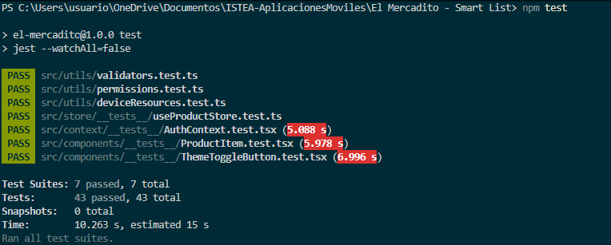

# El Mercadito — Lista de Compras Inteligente

## Opcion Elegida
**Lista de compras inteligente**: Aplicacion movil para gestionar productos de compra con autenticacion local, estado global con Zustand, persistencia offline, acceso a recursos del dispositivo (camara, galeria, ubicacion, contactos y calendario) y recordatorios por notificaciones locales.

---

## Como Ejecutar la App

### Prerrequisitos
- Node.js (v18 o superior)
- Dispositivo movil con **Expo Go** instalado (Android / iOS) o un emulador configurado

### Pasos de ejecucion

1. **Instalar dependencias:**
   ```bash
   npm install
   ```

2. **Iniciar la aplicacion con Expo:**
   ```bash
   npx expo start
   ```
   - **En celular fisico:** Escanear el codigo QR desde la app **Expo Go** (Android) o desde la app Camara (iOS).
   - **En emulador:** Presionar `a` en la terminal para abrir en Android Emulator o `i` para iOS Simulator.

3. **Ejecutar pruebas unitarias (Jest + RNTL):**
   ```bash
   npm test
   ```

---

## Funcionalidades Implementadas

- **Autenticacion Local y Sesion:**
  - Registro de usuarios con validacion de credenciales (minimo 3 caracteres para usuario, 6 para contrasena).
  - Inicio de sesion validando contra usuarios almacenados localmente.
  - Persistencia de sesion activa en `AsyncStorage` (mantiene al usuario logueado al reabrir la app).
  - Cierre de sesion seguro con limpieza de credenciales activas.

- **Navegacion Protegida (React Navigation):**
  - Implementacion de Stack Navigator (`@react-navigation/native-stack`).
  - Rutas condicionadas: usuarios no autenticados solo acceden a *Login* y *Registro*; usuarios autenticados acceden a *Home* y *Alta de Producto*.
  - Soporte para Modo Claro y Modo Oscuro desde la barra de navegacion superior.

- **Gestion de Lista de Compras y Estado Global (Zustand):**
  - **Estado global:** Migracion del manejo de productos desde `useState` local hacia el store global `useProductStore` (Zustand) con acciones para cargar (`loadProducts`), agregar (`addProduct`), actualizar (`updateProduct`) y eliminar (`deleteProduct`) productos.
  - **Alta de productos:** Formulario con validacion de nombre no vacio, generacion de identificador unico y asociacion opcional de foto, ubicacion, contacto y recordatorio de calendario.
  - **Visualizacion y actualizacion:** Lista con `FlatList` conectada mediante selectores al store de Zustand. Permite marcar productos como comprados al tocarlos y recarga los datos del usuario activo con `useFocusEffect`.
  - **Eliminacion y persistencia:** Borrado individual con actualizacion inmediata en el store y persistencia por usuario en `AsyncStorage` (`@shopping_list_<usuario>`).

- **Permisos y Acceso a Recursos del Dispositivo:**
  - **Gestion de permisos (`permissions.ts` y `PermissionsModal.tsx`):** Solicitud de permisos antes de usar cada recurso (camara, galeria, ubicacion, contactos, calendario y notificaciones). Manejo de los estados *Concedido*, *Denegado* y *Pendiente*, mostrando alertas claras al usuario y un aviso en pantalla cuando un permiso es rechazado.
  - **Camara y Galeria (`expo-image-picker`):** Permite tomar una foto con la camara o elegir una imagen de la galeria al crear el producto y mostrar su miniatura en la lista.
  - **Ubicacion GPS (`expo-location`):** Obtiene las coordenadas actuales y la direccion aproximada del comercio donde comprar el producto para mostrarla en el item.
  - **Contactos (`expo-contacts`):** Permite seleccionar un contacto de la agenda del dispositivo para asociarlo al producto como proveedor (nombre y telefono).
  - **Calendario (`expo-calendar`):** Permite crear un evento recordatorio de compra en el calendario del dispositivo vinculado al producto.

- **Notificaciones Locales (Expo SDK 57):**
  - Solicitud de permisos y programacion automatica de una notificacion local de recordatorio de compra (`scheduleShoppingReminder`) disparada a los 5 segundos de guardar un nuevo producto.

- **Componente Reutilizable:**
  - `ProductItem`: Componente modular para cada elemento de la lista con diseno Flexbox que muestra nombre, miniatura de foto, comercio, proveedor, recordatorio de calendario y boton de eliminacion.

- **Testing Automatizado (Jest + React Native Testing Library):**
  - 7 suites de pruebas (43 tests en total) pasando al 100%:
    - `validators.test.ts`: Validacion de credenciales y nombre de producto.
    - `permissions.test.ts`: Estados de permisos (`granted`, `denied`, `undetermined`) y alertas por rechazo.
    - `deviceResources.test.ts`: Pruebas de camara, galeria, ubicacion GPS, contactos y calendario.
    - `useProductStore.test.ts`: Pruebas de agregar, actualizar, eliminar y cargar productos en Zustand.
    - `ProductItem.test.tsx`: Renderizado del producto, sus datos asociados e interaccion de borrado.
    - `AuthContext.test.tsx` y `ThemeToggleButton.test.tsx`: Sesion por usuario y cambio de tema.

---

## Uso de Inteligencia Artificial en el Desarrollo

- **Herramientas utilizadas:**
  - Asistente de IA integrado en el IDE (Antigravity / Gemini) para refactorizacion de estado a Zustand, integracion de modulos nativos de Expo SDK 57 y generacion de pruebas unitarias en Jest.

- **Ejemplos de prompts aplicados:**
  - *Prompt 1 (Contexto y restricciones):* "Ampliar la aplicacion de lista de compras en Expo SDK 57 incorporando permisos y acceso a camara, galeria, ubicacion GPS, contactos y calendario, migrando la lista de productos de useState a un store global con Zustand (acciones para agregar, actualizar y eliminar) y agregando tests en Jest."
  - *Prompt 2 (Resolucion de problema en Expo Go):* "El permiso de calendario no se verifica correctamente en Expo Go aunque este concedido en ajustes. Revisar como funciona expo-calendar en SDK 57 y aplicar una solucion compatible sin romper los tests."

- **Comparacion entre codigo generado y codigo final integrado:**
  - *Permisos de calendario (`src/utils/permissions.ts`):* El codigo generado inicialmente usaba solo `Calendar.getCalendarPermissions()` de la nueva API de SDK 57, la cual no esta soportada dentro de Expo Go. En el codigo final se agrego un bloque `try/catch` con fallback a `expo-calendar/legacy` (`getCalendarPermissionsAsync`) y un listener de `AppState` para actualizar los permisos al volver de la configuracion del telefono.
  - *Generacion de IDs en Zustand (`src/store/useProductStore.ts`):* El codigo inicial usaba `Date.now().toString()`, lo que generaba el mismo ID si se agregaban dos productos en el mismo milisegundo durante los tests. En la version final se ajusto a `` `${Date.now()}-${Math.random().toString(36).slice(2, 7)}` `` para asegurar IDs unicos.

---

## Video DEMO de la App - Parcial 1:

- **Link del video:**
https://youtube.com/shorts/gnMt7LYuLOI?feature=share

---

## Video DEMO de la App - Parcial 2:
- **Link del video:**

---

## Enlace repositorio en GitHub

- **Link del repo:**
https://github.com/angeltirado09/El-Mercadito_SmartList

---

## Imagen de test parcial 1:
